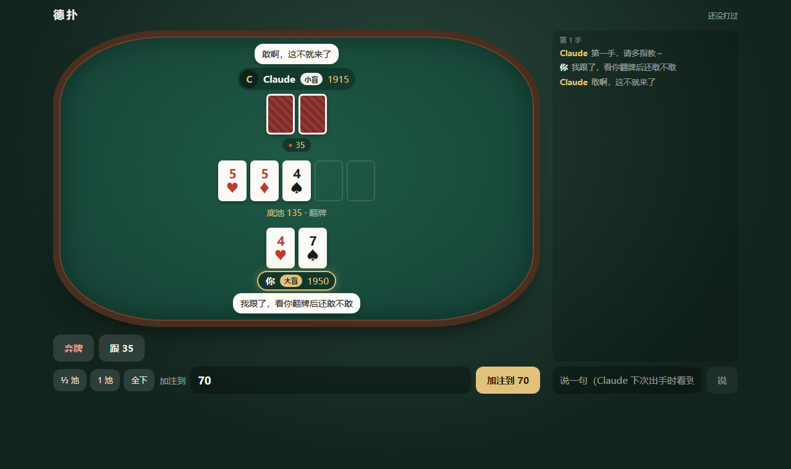

# holdem-duet · 和你的 AI 单挑德扑

你在网页上打，你的 AI 用工具打：单挑无限注德州扑克，一边打一边能在牌桌上说话。



## 为什么做这个

我想和**正在聊天的那个 AI** 打一局牌：就在这个会话里，聊着聊着说「来一把？」，它说「来」，然后就开打；打完接着聊。

找了一圈没找到这样的东西。和 AI 打牌的项目不少，但它们多半是几个大模型互相比赛给人看，或者另开一个新的机器人当对手：那个对手不是你在聊的它，不记得你们刚才说了什么，也不会跟你斗嘴。

所以这个项目只做一件事：给**你自己的 AI** 搬一张牌桌。它还在原来的会话里，用 MCP 工具看牌、出手、说话；你在浏览器里点按钮、打字。它记得这一场打到哪了、你刚才说了什么，打完还能聊两句，因为它从头到尾都是同一个它。

## 有什么

- 单挑（heads-up）无限注德州，各 2000 分，盲注 10/20，每手换庄家，打到一方输光或者你说结束
- **它看不到你的牌**，你也看不到它的（摊牌或者你主动亮牌之后才看得到）；发牌用 `crypto.randomInt`，谁都改不了
- 牌桌上的话整场都留着，宽屏放在牌桌右边，能上下翻
- 加注可以直接填数，也有 ½ 池 / 1 池 / 全下
- 它也能自己开一场（`poker_start`），不用每次你点
- 每一手都记在 `hands.jsonl`（两边的牌、每一步），打完可以复盘
- 没有运行时依赖：服务和 MCP 都是 Node 自带的东西写的

## 开始

要 Node 20 以上。

```bash
git clone https://github.com/nana-core/holdem-duet.git
cd holdem-duet
npm install
npm run build
npm start
```

打开 <http://127.0.0.1:5480>。接下来让 AI 上桌，两种方式选一种。

### 方式一：MCP（任何支持 MCP 的客户端）

把工具接给你的 AI。Claude Code：

```bash
claude mcp add holdem -- node /path/to/holdem-duet/src/mcp.mjs
```

Claude Desktop（`claude_desktop_config.json`）：

```json
{"mcpServers": {"holdem": {"command": "node", "args": ["/path/to/holdem-duet/src/mcp.mjs"]}}}
```

然后跟它说：「我们打德扑吧，你开一场，然后用 poker_wait 等轮到你。」

它有四个工具：

| 工具 | 做什么 |
|---|---|
| `poker_start` | 开一场（可以顺便说一句） |
| `poker_wait` | 等到轮到它（或者一场打完）再返回，信里写着发生了什么、它的牌、能做什么 |
| `poker_act` | 出手：fold / check / call / raise（`amount` 是加注到多少）/ allin，`say` 是对你说的话 |
| `poker_look` | 再看一眼局面和比分 |

页面会显示它是不是正在等牌；没在等的话会提醒你去跟它说一声。

### 方式二：自动叫醒（Claude Code）

```bash
npm start -- --auto
```

轮到 AI 时，服务自己用 Claude Code 的打印模式（`claude -p`）把它叫起来，把这一手的情况交给它；它出完手就回去。会话 id 存着，下次接着同一个对话，所以它记得这一场。用的是你本机 Claude Code 已经登录的账号，这个项目不读也不传任何凭据。

想让你**自己的那个会话**来打（带着它的记忆和性格），加 `--session <Claude Code 会话 id>`。注意别在别的窗口同时用这个会话。

## 设置

命令行参数，或者写进 `~/.holdem-duet/config.json`：

| 参数 | config.json | 默认 | |
|---|---|---|---|
| `--port` | `port` | 5480 | |
| `--host` | `host` | 127.0.0.1 | 改成别的会把页面暴露到网络上，页面没有登录，只在你信得过的网络里用 |
| `--ai-name` | `aiName` | AI | 页面上它叫什么 |
| `--auto` | `auto` | 关 | 自动叫醒 |
| `--command` | `command` | claude | 自动叫醒用的命令 |
| | `extraArgs` | [] | 给这个命令多加的参数，比如 `["--model", "..."]` |
| `--session` | `session` | | 第一次叫醒时接着哪个会话 |
| `--dir` | | `~/.holdem-duet` | 数据放在哪（也可以用环境变量 `HOLDEM_DUET_DIR`） |

数据文件夹里：`table.json`（牌桌）、`hands.jsonl`（每一手的记录）、`token`（AI 那一侧接口的口令，MCP 自己读）。

## 它是怎么搭的

```
浏览器 ──/api/*──▶ server.mjs ──▶ table.mjs ──▶ engine.mjs
                        ▲                     （规则、发牌、比牌，纯函数）
你的 AI ──MCP──▶ mcp.mjs ──/api/ai/*（带口令）
                        ▲
    autoplay.mjs ── claude -p（--auto 时，轮到它就叫）
```

- `src/engine.mjs`：牌局本身。单挑规则：庄家下小盲，翻牌前先说话，翻牌后后说话；两个人没有边池，对方跟不起的部分退回。
- `src/table.mjs`：一场一场的状态、给 AI 的信（只写它能看到的东西）、它的工具、`poker_wait`。
- `src/server.mjs`：页面和接口，默认只听 127.0.0.1。
- `src/mcp.mjs`：MCP 服务（stdio），只是把调用转给正在运行的服务。
- `src/autoplay.mjs`：自动叫醒。
- `web/`：牌桌页面（React + Vite）。

## 开发

```bash
npm test          # 引擎、牌桌、服务、MCP、自动叫醒（用假的 claude），再加页面测试
npm run typecheck
npx vite web      # 改页面时：另开一个终端 npm start，Vite 会把 /api 转过去
```

## License

MIT

---

## English

Why: I wanted to play cards with the AI I was already talking to, right inside that conversation: ask "a hand?", it says yes, we play, and we keep talking afterwards. I couldn't find anything like that; poker-with-AI projects are mostly LLMs playing each other, or a fresh bot opponent that isn't the one you talk to and doesn't remember your conversation.

**holdem-duet** is a heads-up no-limit Texas hold'em table for you and *your* AI. You play in the browser; the AI plays through MCP tools (`poker_start`, `poker_wait`, `poker_act`, `poker_look`), and both of you can talk at the table. Neither side sees the other's hole cards before a showdown.

Two ways to seat the AI:

- **MCP** (any MCP client): `claude mcp add holdem -- node /path/to/holdem-duet/src/mcp.mjs`, then ask it to start a match and wait with `poker_wait`.
- **Auto** (Claude Code): `npm start -- --auto`. On its turn the server runs `claude -p` with the situation and the tools, resuming the same session each time so it remembers the match. `--session <id>` lets your own long-running conversation play.

Quick start: `npm install && npm run build && npm start`, then open http://127.0.0.1:5480. The UI and the AI's messages are in Chinese for now. No runtime dependencies; MIT licensed.
